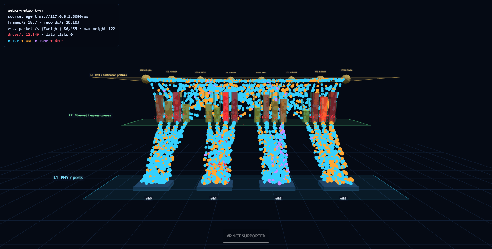

# webxr-network-vr

Walk through your network in VR. A Go agent turns packet headers into fixed
32-byte records (eBPF/XDP on Linux, pcap replay or a synthetic generator
anywhere), samples them down to a renderable rate, and streams 20 Hz
MessagePack frames over WebSocket to a Three.js + WebXR viewer that draws
L1 ports, L2 egress queues and L3 destination prefixes as stacked layers,
with packets flowing between them and queue drops bursting in red.



*Desktop view of the viewer fed by `agent --synth --pps 60000`, taken during a
micro-burst. Cyan = TCP, orange = UDP, violet = ICMP, red = drops. In a WebXR
headset, the same scene is rendered at room scale.*

## Architecture

```
  Linux kernel                     agent (Go)                                browser
 +-------------+   ringbuf    +-------------------------------------+   ws  +------------------------+
 | bpf/xdp.c   |--32B recs--->| capture/xdp  (linux only)           |       | web/ (Three.js+WebXR)  |
 | XDP_PASS,   |              | capture/pcap (-tags pcap, pure Go)  |       |                        |
 | observe-only|              | capture/synth (any OS)              |       |  L3  o  o  o  o  o  o   |
 +-------------+              |          |                          |       |       \ | /  \ | /     |
                              |          v                          |       |  L2  |#| |#| |#| |#|   |
                              |   sampler: k-sampling, HH bucket,   |       |        ^   ^   ^   ^   |
                              |            drop aggregation         |       |  L1  [eth0][eth1]...    |
                              |          |                          |       |                        |
                              |          v                          | 20 Hz |  InstancedMesh packets |
                              |   frame.Batcher (50 ms) -> msgpack  |------>|  queue-depth bars      |
                              |          |                          | /ws   |  drop bursts, labels   |
                              |   server.Hub (per-client buffer,    |       |  demo mode w/o agent   |
                              |               dropped_ticks)        |       +------------------------+
                              +-------------------------------------+
```

## The 32-byte record

Little-endian, every field naturally aligned. Defined once in
[`internal/record/record.go`](internal/record/record.go), mirrored by
[`bpf/xdp.c`](bpf/xdp.c) and [`web/src/record.js`](web/src/record.js), and
pinned for both Go and JS by [`testdata/record_golden.json`](testdata/record_golden.json).

| off | size | field           | meaning                                                     |
|----:|-----:|-----------------|-------------------------------------------------------------|
|   0 |    8 | `ts_ns`         | capture time, ns (monotonic)                                |
|   8 |    4 | `flow_hash`     | FNV-1a over src_ip, dst_ip, src_port, dst_port, proto       |
|  12 |    4 | `src_ip`        | IPv4 source, raw network-order bytes                        |
|  16 |    4 | `dst_ip`        | IPv4 destination, raw network-order bytes                   |
|  20 |    2 | `src_port`      | L4 source port (0 if not TCP/UDP)                           |
|  22 |    2 | `dst_port`      | L4 destination port                                         |
|  24 |    2 | `pkt_len`       | L2 frame length, saturates at 65535                         |
|  26 |    1 | `proto`         | IP protocol (6 TCP, 17 UDP, 1 ICMP)                         |
|  27 |    1 | `dev`           | agent-local device index                                    |
|  28 |    1 | `queue`         | rx/tx queue index                                           |
|  29 |    1 | `verdict`       | bit 7 = aggregated drop record; bits 0-6 = drop reason (0 = forwarded, 1 queue full, 2 policy, 3 no route) |
|  30 |    2 | `sample_weight` | number of real packets this record represents               |

## Frames

One MessagePack map per 50 ms tick:

| key             | type   | meaning                                                         |
|-----------------|--------|-----------------------------------------------------------------|
| `tick_ms`       | uint   | tick length (50)                                                |
| `base_ts_ns`    | uint64 | smallest `ts_ns` in the frame                                   |
| `count`         | uint   | number of records                                               |
| `dropped_ticks` | uint   | ticks this client missed since its previous frame (slow socket or late producer tick) |
| `records`       | bin    | `count * 32` bytes                                              |

## Sampling rules

Implemented in [`internal/sampler`](internal/sampler/sampler.go); the browser demo
source re-implements the same rules in [`web/src/demo.js`](web/src/demo.js).

1. **Drops are never sampled.** Every dropped packet is kept with weight 1.
   If a tick sees more than **1,000** drops, that tick's drops are collapsed into one
   aggregate record per `(dev, queue, reason)` with `sample_weight` = count
   (split at 65,535) and the aggregate bit set.
2. **Flow k-sampling for forwarded packets.** `k = ceil(pps / 50,000)`, clamped to
   `[1, 32]`, where `pps` is measured over the previous tick. A flow is kept when
   `murmur3_fmix32(flow_hash) % k == 0`, so a kept flow is kept *whole* (no
   per-packet holes) and each kept record carries `sample_weight = k`.
3. **Heavy-hitter token bucket.** Each kept flow may emit at most **200 records/s**
   (burst 10). Throttled packets are not lost: their weight is carried into that
   flow's next emitted record, so `sum(sample_weight)` still adds up.

`sum(sample_weight)` is therefore exact for drops and an unbiased-in-expectation
estimate for forwarded traffic. Because whole flows are sampled, the estimate has
the variance of the flow-size distribution: with a few Zipf heavy hitters it can
be off by 10-20% at k = 2 (see the agent log below).

## Running

Requirements: Go 1.27+, Node 22+ (for the viewer build). Nothing else for the
synthetic and pcap modes; clang + libbpf headers + root for XDP.

```sh
# 1. build the viewer once (local three.js / msgpack deps, no CDN)
cd web && npm ci && npm run build && cd ..

# 2. run the agent with synthetic traffic and serve the viewer
go run ./cmd/agent --synth --pps 60000 --web web/dist      # open http://localhost:8080

# 3. or open the viewer with no agent at all (in-browser demo source)
cd web && npm run dev    # http://localhost:5173/?demo&pps=120000
```

Other sources:

```sh
go run -tags pcap ./cmd/agent --pcap trace.pcap --web web/dist   # replay at capture speed
clang -O2 -g -target bpf -I/usr/include/$(uname -m)-linux-gnu -c bpf/xdp.c -o bpf/xdp.o
sudo go run ./cmd/agent --xdp-iface eth0 --xdp-obj bpf/xdp.o --web web/dist   # Linux only
```

Viewer URL parameters: `?ws=ws://host:8080/ws` (agent elsewhere), `?demo` (force the
demo source), `pps=` and `seed=` (demo load). If no agent answers within 1.5 s the
viewer falls back to the demo source. Click **ENTER VR** on a WebXR-capable browser
(Quest Browser, or Chrome with a headset/emulator) to step into the scene; WebXR needs
`https://` or `localhost`.

Agent flags: `--synth`, `--pps`, `--seed`, `--pcap FILE`, `--xdp-iface IFACE`,
`--xdp-obj PATH`, `--addr` (default `:8080`), `--web DIR`, `--duration`, `--quiet`.

Example agent log at `--synth --pps 60000` (one line per second; the generator adds a
3x micro-burst for 250 ms every 2 s, so every other second shows the burst):

```
msg=stats pps_in=60026 k=2 records_out=21006 sampled_out=23854 hh_throttled=15166 drops=398   drop_agg_ticks=0 weight_sum=71940
msg=stats pps_in=90068 k=4 records_out=21489 sampled_out=39874 hh_throttled=16419 drops=12705 drop_agg_ticks=5 weight_sum=104085
```

## Tests

```sh
go vet ./... && go test -tags pcap ./...      # record golden vectors, sampler rules, frame codec,
                                              # synth model, pcap parsing, websocket hub
cd web && npm test                            # JS codec vs the same golden vectors, demo source
```

CI (`.github/workflows/ci.yml`, ubuntu) runs gofmt, vet (also for `GOOS=windows`), race
tests, builds, a 3 s 60k pps smoke run that must report `k=2`, compiles `bpf/xdp.c`
with clang, and runs the web tests and production build.

## Status

Implemented:

- 32-byte record codec with golden vectors shared by Go and JS
- sampler: adaptive k, whole-flow sampling, heavy-hitter token bucket with weight carry,
  never-sampled drops with per-tick `(dev, queue, reason)` aggregation
- 20 Hz batcher, MessagePack frames, late-tick and slow-client `dropped_ticks`
- WebSocket hub with per-client bounded buffers; optional static serving of the viewer
- synthetic generator (Zipf flows, per-queue service model, micro-bursts) for any OS
- pure-Go pcap replay (`-tags pcap`)
- XDP program (`bpf/xdp.c`) and cilium/ebpf ring-buffer loader, **Linux only**
  (`internal/capture/xdp` builds to a stub on other OSes)
- Three.js + WebXR viewer: instanced packets L1 -> L2 -> L3, queue pressure bars, drop
  bursts, layer/port/prefix labels, HUD, in-browser demo mode

Not yet / roadmap:

- The XDP path is compiled in CI but has not been exercised against a live NIC in CI
  (needs root + a real or veth interface); it only sees ingress, so it reports no drops.
  Kernel drop reasons via the `skb:kfree_skb` tracepoint are the next step.
- Real queue depth (qdisc / `tc` stats) instead of the viewer's pressure estimate
- In-kernel pre-sampling at very high rates (k pushed into a BPF map)
- IPv6 and VLAN parsing; multi-interface `dev` mapping
- VR interaction: controller ray to inspect a flow, filters, time scrubbing

## License

MIT, see [LICENSE](LICENSE). `bpf/xdp.c` is dual MIT/GPL-2.0 so the kernel accepts it.
